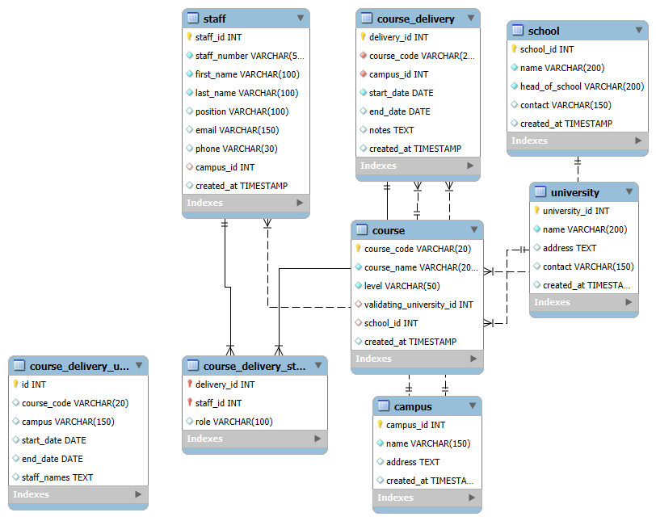
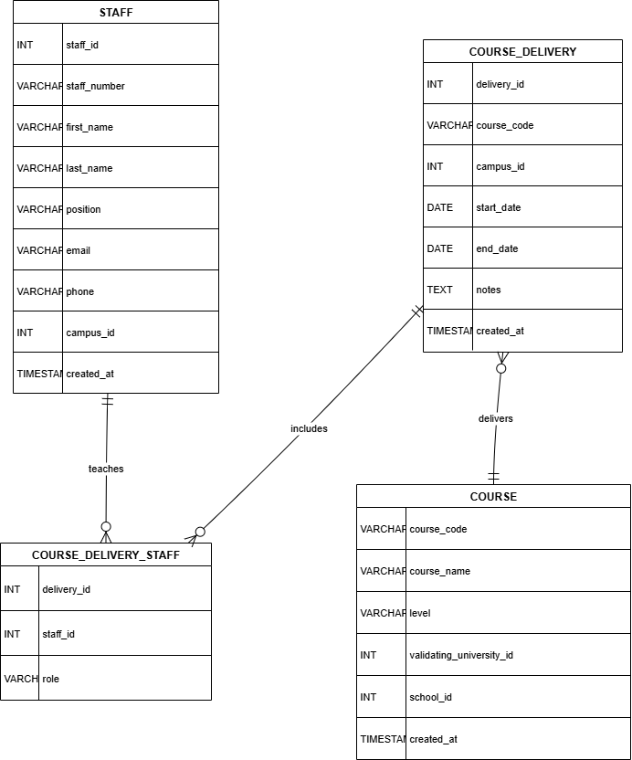

# College Course Delivery Database (MySQL)

Relational database design for a multi-campus college that runs programmes validated by different UK universities. It tracks universities, schools, campuses, staff, courses, and which staff teach each course at each campus.

> University coursework: *Databases*, BSc (Hons) Computing at Regent College London.

## Entity Relationship Diagram



## Design

| Table | Purpose |
|---|---|
| `university` | Validating universities |
| `school` | Academic schools inside the college |
| `campus` | Physical teaching locations |
| `staff` | Academic and admin staff, each based at one campus |
| `course` | Programmes, each run by one school and validated by one university |
| `course_delivery` | When and where a course is taught |
| `course_delivery_staff` | Associative table: which staff teach each delivery, and their role |

**Relationships**
- One university validates many courses (1:M)
- One school offers many courses (1:M)
- One campus hosts many deliveries and employs many staff (1:M)
- Courses ↔ campuses and deliveries ↔ staff are many-to-many, resolved with `course_delivery` and `course_delivery_staff`

## Normalisation

The design was normalised to **Third Normal Form (3NF)**. For example, an unnormalised delivery table stored several lecturers in one field (`"Anita Sharma, Omar Ali"`). That breaks 1NF, so the staff were moved into the `course_delivery_staff` table, with one row per lecturer.



## Data integrity

- Primary and foreign keys on every relationship
- `UNIQUE` on staff number and email
- `CHECK` that a delivery's end date is not before its start date
- `ON DELETE CASCADE` so removing a delivery also removes its staff assignments

## How to run

```bash
mysql -u root -p < schema.sql
mysql -u root -p < sample_data.sql
```

Or open the files in **MySQL Workbench** and run them in order. `sample_data.sql` adds fictional records and an example `JOIN` query.

## Author

**Gabriel Malini Rodrigues** · [LinkedIn](https://www.linkedin.com/in/gabriel-malini)
